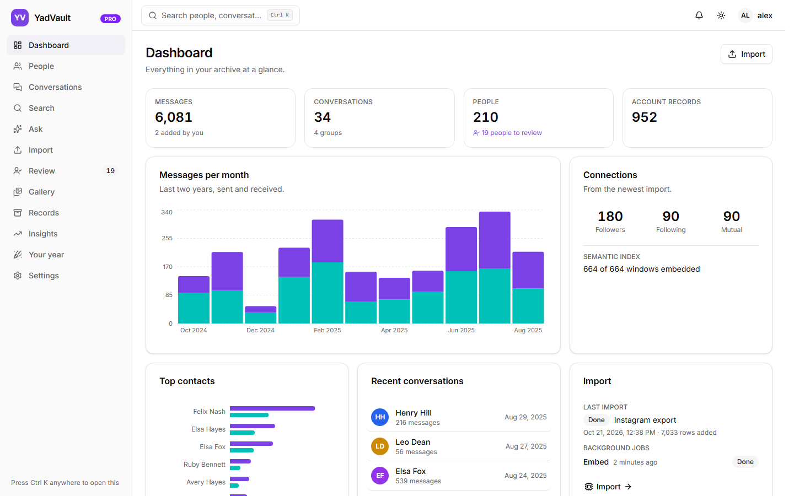
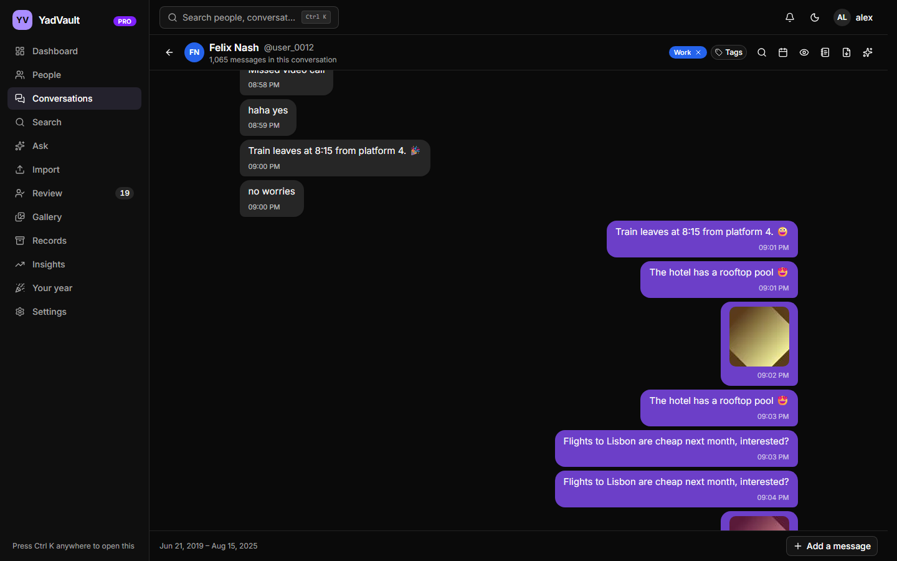
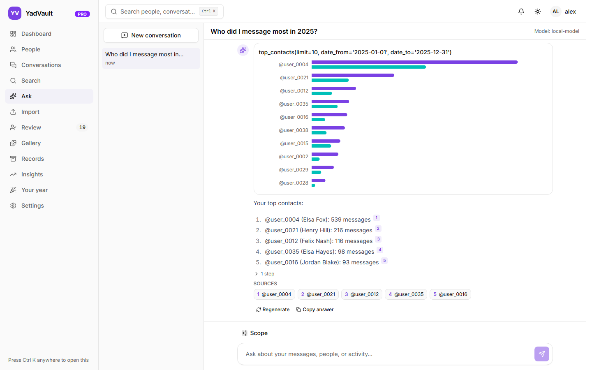
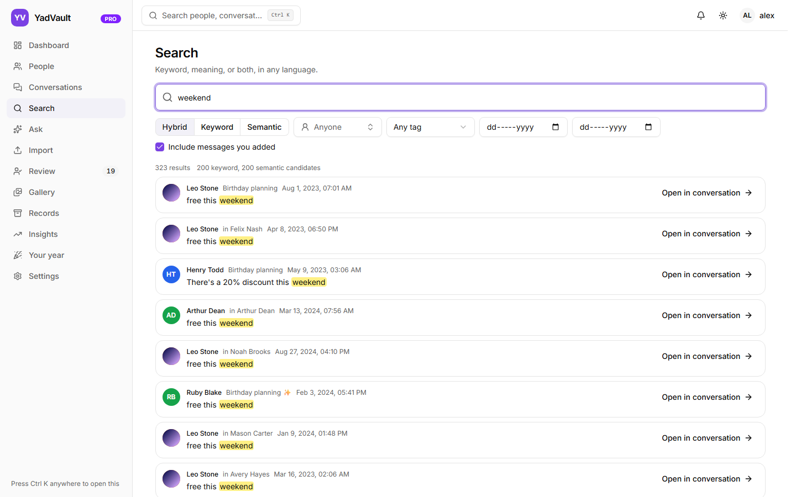

# YadVault

Self-hosted archive for your Instagram data export. Import the official export
(millions of messages, followers, following and every other account file), browse and search it
in any language, see who you talk to and when, and ask questions about it in plain
language with any model, through your own LLM gateway ([LiteLLM](https://github.com/BerriAI/litellm),
Ollama or any other OpenAI-compatible API).
Runs on your machine with Docker. Nothing leaves it.

| | |
|---|---|
|  |  |
|  |  |

The screenshots show made-up data: no real export, name or username.

## What it does

- **Imports the export Instagram gives you**, zip parts or folders, resumable, with millions of
  messages: about 100 seconds per million on a desktop. Re-importing a newer export adds only
  what is new and keeps track of username and name changes.
- **Facebook Messenger as well**: a Messenger export (its classic conversation files and the newer
  encrypted-chat files) is imported beside Instagram and marked as Messenger. Your Facebook name
  joins you; each Messenger friend is one person that you can link with their Instagram account
  in the review (suggested when the names match).
- **Matches names to accounts** across direct messages, groups, followers and the rest of the
  export, with a review queue for the ambiguous ones. Never merges two people on a name alone.
- **Search** by keyword, by meaning (Pro: an embedding model on your server or at your LLM
  gateway) or both, with filters for people, conversations, tags and dates.
- **Browse** conversations with infinite scroll in both directions, jump to a date, tags (shared
  between a person and your 1:1 conversation with them), and
  messages you add yourself, kept apart from the originals and shown in their own colour.
- **Install on a NAS** with the templates in [install/](install/README.md): Synology, TrueNAS SCALE,
  Unraid, CasaOS and umbrelOS.
- **Backups in Settings**: back up now or every day or week, keep the newest few, encrypted with
  a key that never stays on the server, and download them to keep a copy elsewhere (free).
- **Save a conversation as PDF**, whole or some days of it, with its photos, in any script. An
  **evidence copy** (Pro) adds the exact time of every message in UTC, where it came from in the
  export and a SHA-256 checksum, so anyone with the original export can check each message against
  it (`yadvault evidence verify` prints what the export says for each, to compare with the pages;
  see [docs/evidence.md](docs/evidence.md)).
- **Photos, videos and voice messages**, if you want them: the import shows how many there are
  and how much space they take, and copies the kinds you choose as a job of its own (the same
  file in a later export takes no more space). They play inside the conversations; the gallery
  (Pro) shows everything together, including your own posts, stories and reels.
- **Unfollower tracker.** Drop a new export into the watch folder and it is imported on its own;
  the bell says who unfollowed you and who started to (and, if you want, a webhook such as ntfy,
  with counts only).
- **What Instagram knows about you.** A report of the export's own account data: the topics it
  thinks interest you, advertisers using your information, ads seen, logins and where from,
  devices, the details it keeps about you, and everything else it records, area by area.
- **On this day.** The dashboard shows today in earlier years: who you wrote with, a first
  message to remember the day by, photos and new followers; any other day on its own page.
- **Your year.** One year in numbers: messages, people, streaks, busiest day, when you write,
  the people you wrote with most, reactions and follows; and a picture to share, drawn in your
  browser, with numbers and (only if you want) first names, never what anyone wrote.
- **Bulk sync (add-on, Pro, off by default).** Looks the people in your archive up the way
  anyone can without logging in: picture, public details and the latest posts and reels Instagram
  shows logged-out visitors, in a
  queue that starts slowly, speeds up a little while all is well and pauses on its own when
  Instagram pushes back; estimates and a warning first, a storage cap, videos only if you want
  them. It never logs in. The free version shows 3 posts per person, Pro all of them.
- **AI extras (Pro)** through your gateway's models: voice messages written out, photos described
  so you can find them by what is in them, and a summary of any conversation in one click.
- **Ask** anything (Pro): the model plans, calls read-only tools over your archive and answers with
  charts, person cards and numbered citations that open the conversation at the cited message.
  Models come from your LLM gateway; the archive sends its own tool definitions and runs them
  itself. The same tools are available to Open WebUI or any other MCP client over an MCP
  server.
- **Account insights.** Who followed or unfollowed you and between which exports (compared by account, so a renamed username is not a false alarm, and in the order the exports were made), who keeps unfollowing and following again, whom you unfollowed and when, each person's follow history, who does not follow back, when follows started, and what the export records about your likes, comments, saves, searches and logins.
- **Private by design.** Login required, roles, CSRF protection, rate limits, hashed tokens, an
  audit log without content, logs without content, no telemetry, no CDNs, bundled fonts. The
  only container that can reach Instagram is the optional, off-by-default picture fetcher.

## Free and Pro

Without a license key YadVault runs as the free version: your 200 most recent conversations, 200
people, the 5 newest records of each kind, the Insights summary and one account. **YadVault Pro**
adds the whole archive, Ask, semantic search, the MCP server, notes, exports, more accounts and
single sign-on. Enter a key in Settings → License or set `YADVAULT_LICENSE_KEY`; it unlocks
everything at once, without importing again. Keys are checked on your server, offline.
[docs/licensing.md](docs/licensing.md) has the details.

## Quick start

You need Docker Engine with Compose v2 on a Linux, macOS or Windows machine on your LAN, about
4 GB of RAM (8 GB for the larger embedding models, less when your LLM gateway provides the
embeddings), and disk space for the export plus roughly
0.6 GB of database per million messages.

```bash
git clone https://github.com/PersianGru/YadVault.git yadvault
cd yadvault
cp .env.example .env
```

This repository holds the deployment files and the documentation; YadVault itself comes as
prebuilt images from the GitHub Container Registry (`ghcr.io/persiangru/yadvault`). Each release
of this repository pins the images of that release (`YADVAULT_VERSION` in `.env`).

Open `.env` and set the two passwords (`POSTGRES_PASSWORD` and `YADVAULT_RO_PASSWORD`; any long
random strings, for example from `openssl rand -hex 24`). Everything else has a sensible default.
Then:

```bash
docker compose up -d
```

The first start pulls the images, downloads the embedding model once (about 0.5 GB, into a
Docker volume; `docker compose logs -f embeddings-download` shows progress) and runs the database
migrations. Open `http://<your-server>:8000` and create the admin account in the setup wizard.
It asks for a one-time setup code, which the app prints to its log
(`docker compose logs app | grep "setup code"`), so nobody else on the network can claim the
archive first. Optionally connect your LLM gateway, and go to **Import**.

### Getting your Instagram export

In the Instagram app or website: *Settings → Accounts Center → Your information and permissions →
Download your information*. Choose your account, **all of your information** (or at least
messages, followers and following), **all time**, format **JSON**, and a media quality you are
happy with (lower is faster to download and import). Instagram prepares the export in the
background, sometimes for days, and sends one or more zip files.

Drop those zip files on the Import page. For very large exports, copy them into the server
folder instead and pick them there:

```bash
docker compose cp ./my-export-part1.zip app:/data/import/
```

### Connecting a model for Ask

Ask needs an LLM gateway: any OpenAI-compatible API you already run, such as
[LiteLLM](https://github.com/BerriAI/litellm). In the app's Settings → LLM gateway, enter its API
root (LiteLLM `http://<host>:4000/v1`, Ollama `http://<host>:11434/v1`, Open WebUI
`http://<host>:3000/api`; an address without a path gets `/v1`), an API key (for LiteLLM a
virtual key) and pick a model that supports tool calling. The app shows a warning when you pick a
model: message content goes wherever the model runs, so prefer local models.

No gateway yet? The `llm` profile starts Ollama (and Open WebUI as a chat UI) next to the archive:

```bash
docker compose --profile llm up -d
docker compose exec ollama ollama pull qwen2.5:7b     # or any model that supports tool calling
```

Then use `http://ollama:11434/v1` as the gateway address (no key needed).

Open WebUI connects the other way round: its chat uses the archive's tools over MCP. The app
serves them at `/mcp` on its own address (`http://<your-server>:8000/mcp`, or `https://...` with
HTTPS on): create a token in the archive's Settings → MCP tokens, and add that address as an MCP
(Streamable HTTP) connection in Open WebUI. Details in [docs/api.md](docs/api.md).

## Configuration

Everything is in `.env`; [.env.example](.env.example) documents every value. The ones people
change most:

| Variable | What it does |
|---|---|
| `YADVAULT_LICENSE_KEY` | A YadVault Pro license key (or enter it in Settings → License); see [docs/licensing.md](docs/licensing.md) |
| `BIND_ADDRESS` | Interface the ports bind to; `0.0.0.0` (default) is the whole host, set your LAN address to be explicit |
| `PORT` | Port of the web UI and API (8000) |
| `LLM_GATEWAY_URL`, `LLM_GATEWAY_API_KEY`, `LLM_GATEWAY_MODEL` | The LLM gateway for Ask (can also be set in the UI; the older `OPEN_WEBUI_*` names still work) |
| `EMBEDDINGS_PROVIDER`, `COMPOSE_PROFILES` | Semantic search on this server (`local`, profile `embeddings`), through the LLM gateway (`gateway`) or `off`; also in Settings |
| `EMBEDDINGS_MODEL`, `EMBEDDINGS_DEVICE` | The local embedding model and `cpu` or `cuda` (see [docker-compose.gpu.yml](docker-compose.gpu.yml)); choices in [docs/operations.md](docs/operations.md#semantic-search) |
| `ENABLE_ANNOTATIONS`, `ENABLE_SQL_TOOL` | Let the model add notes and tags, or run read-only SQL; both off by default |
| `AVATAR_FETCHER_URL`, `ENABLE_AVATAR_FETCH` | The optional Bulk sync add-on's fetcher (profile `avatars`, Pro), off by default |
| `*_MEMORY_LIMIT` | Container memory limits |

Profiles: `embeddings` (semantic search on this server), `avatars` (picture fetcher, the only
service with Instagram access), `llm` (Ollama, plus Open WebUI as a chat UI). Start a profile with
`docker compose --profile <name> up -d`. HTTPS on the LAN is optional: the override file
`docker-compose.https.yml` puts Caddy in front of the app, with its own certificate authority or a
Let's Encrypt certificate ([docs/https.md](docs/https.md)).

## Operations

- **Update:** take a backup, `git pull` this repository (or check out a release tag), compare
  `.env.example` with your `.env` and set `YADVAULT_VERSION` to the new release, then
  `docker compose pull && docker compose up -d`. Migrations run automatically at start, protected
  by a lock. Release notes are in [CHANGELOG.md](CHANGELOG.md).
- **Backups:** `scripts/backup.sh <age public key>` writes an encrypted file with the database
  and your added data (avatars, attachments, copied media; `NO_MEDIA=1` leaves the media out);
  `scripts/restore.sh` restores it. Without Docker, `yadvault backup` and `yadvault restore` do
  the same.
- **Storage:** Settings → Storage shows what takes space (down to each conversation and person)
  and cleans up left-over uploads, thumbnails, copied media and the semantic search index.
- **Logs:** `docker compose logs -f app worker`; one JSON line per event, never message content.
- **Network:** keep the ports on your LAN. [docs/operations.md](docs/operations.md) has firewall
  guidance, GPU use, resource limits and troubleshooting; [docs/https.md](docs/https.md) covers HTTPS.

## Security and privacy

Login is required for everything, admin and read-only roles exist, sessions and tokens are
stored hashed, writes need a CSRF header, logins are rate-limited, and the AI tools run with a
read-only database role. Message content is treated as untrusted input everywhere: tool results
reach the model wrapped as data, the tools are read-only unless you switch the two optional ones
on, and no AI feature ever acts on content. The app never connects to Instagram; the optional
fetcher does, anonymously, only when you click, and only from its own container.
With Pro, people can also sign in with Microsoft Entra ID or Okta, with admin and read-only
roles from their app roles or groups ([docs/sso.md](docs/sso.md)).
[docs/security.md](docs/security.md) describes the model in full, and
[docs/encryption.md](docs/encryption.md) what is encrypted at rest and how to encrypt the rest. To report a vulnerability, see
[SECURITY.md](SECURITY.md).

## Support

Questions and problems: open an issue in this repository (never attach your export or anything
from it). Security problems: see [SECURITY.md](SECURITY.md).

## License

Copyright (c) 2026 PersianGru. You may use, copy and modify the deployment files in this
repository to run YadVault; see [LICENSE](LICENSE). The YadVault software in the images is
proprietary and governed by its end-user license agreement.

